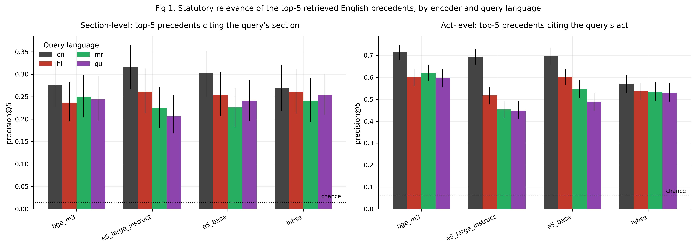
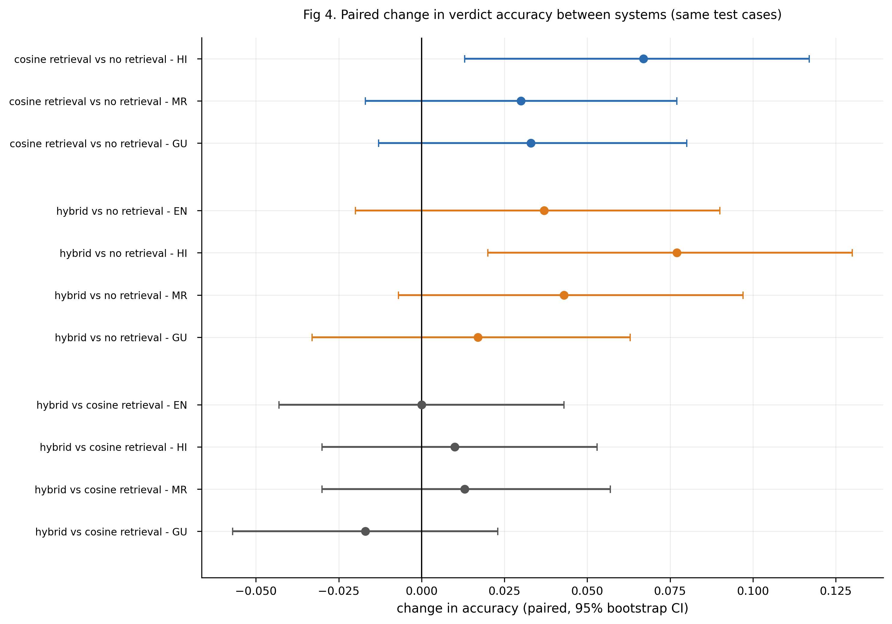

# NyaySetu-Indic

**Cross-lingual retrieval-augmented judgment prediction for Indian Supreme Court cases, with queries in Hindi, Marathi and Gujarati over an English case corpus.**

NyaySetu-Indic ("Nyay" = justice, "Setu" = bridge) extends the [NyayaRAG](https://arxiv.org/abs/2508.00709) setting (retrieval-augmented legal judgment prediction) to Indian languages. The cases and the retrieval corpus stay in English; only the **queries** are translated. The project asks whether a Hindi, Marathi or Gujarati case description can retrieve the right English precedents, and whether those precedents help a language model predict the outcome and explain it in the query's language.

> **Status:** completed student research project. The pipeline, benchmark and evaluation are finished. The headline result is a negative one: **verdict prediction is not significantly better than the majority-class baseline for any system**, while **cross-lingual retrieval of statutorily relevant precedents clearly works**. Details, caveats and limitations are below.

---

## 1. Contributions

1. **A multilingual benchmark.** 360 held-out cases (300 test + 60 dev) with queries translated into Hindi, Marathi and Gujarati using a legal-domain translation model, plus sentence-level review sheets for native-speaker checking.
2. **Language-invariant legal anchors.** An extractor that turns section numbers, act years and the big codes (IPC, CrPC, CPC, Constitution) in English, Hindi, Marathi or Gujarati text into canonical IDs, so a query in any language can be matched to English precedents by what they cite.
3. **A cross-lingual retriever.** Multilingual embeddings (four encoders compared) with an optional hybrid rerank: `alpha * cosine + (1 - alpha) * IDF-weighted anchor overlap`.
4. **Verdict and reasoning in the query language.** An LLM is given the case plus the top retrieved precedents *with their outcomes* and returns a verdict (from next-token probabilities) and an explanation in the query's language.
5. **Evaluation.** Accuracy, macro-F1, AUC, bootstrap confidence intervals, paired tests, kNN-vote and statutory-relevance retrieval metrics, stratification by anchor availability, and cross-lingual consistency.

## 2. Pipeline

```
case (hi / mr / gu)
  -> extract anchors (kept aside)
  -> multilingual encoder (BGE-M3 / mE5-large-instruct / mE5-base / LaBSE, 512 tokens)
  -> cosine search over the ENGLISH train corpus (held-out cases excluded)
  -> hybrid rerank: alpha * cosine + (1 - alpha) * IDF-weighted anchor overlap   (alpha = 0.7, fixed in advance)
  -> LLM prompt: case + top precedents WITH their outcomes
  -> verdict (ALLOWED vs DISMISSED, from next-token probabilities) + explanation in the query language
```

Systems compared in the end-to-end evaluation:

| Code | System | Query |
|---|---|---|
| `none` | LLM with no retrieved precedents | en / hi / mr / gu |
| `cos` | LLM + top precedents by cosine similarity | en / hi / mr / gu |
| `hyb` | LLM + top precedents after the anchor-hybrid rerank | en / hi / mr / gu |

## 3. Data

| Item | Value |
|---|---|
| Source | Hugging Face `L-NLProc/NyayaRAG` (Supreme Court summaries) |
| Input cases / retrieval summaries | 4,962 / 54,782 |
| Labels | `0` rejected/dismissed, `1` allowed, `2` partial. Meanings were **inferred from ruling text, not documented**. Only binary 0/1 is used. |
| Query text | **Facts + Issues + Statute only.** Ratio, Ruling and Conclusion are never shown for a test case. |
| Evaluation pool | 3,952 binary cases with at least 80 words; held-out **300 test + 60 dev**, stratified, seed 42 |
| Retrieval corpus | 52,947 English summaries (held-out ids removed), of which **23,883 have a binary label** |
| Test balance | 49.7% allowed; **majority-class baseline = 0.503** |
| Anchor strata of the 360 queries | 166 with a section anchor, 150 act-only, 44 with no anchor |

**Leakage check** (TF-IDF + logistic regression, 5-fold, binary). This is why the query excludes the ruling:

| Input | Accuracy |
|---|---|
| Majority class | 0.508 |
| Facts + issues + statute (our query) | 0.568 |
| + ratio | 0.584 |
| + ruling + conclusion | 0.705 |
| ruling + conclusion only | 0.755 |

Query-only TF-IDF reaches about 0.59 (vs 0.505 baseline), which is the realistic ceiling for outcome prediction from this input. 11.8% of queries still contain verdict-like sentences (mostly lower-court history); masking them changed TF-IDF accuracy only from 0.592 to 0.586, so the original query is the main setting.

## 4. Translation

Queries were translated with `law-ai/InLegalTrans-En2Indic-1B` (a legal fine-tune of IndicTrans2), using beam 5 with a 4-best selection that prefers a candidate whose digits match the English. On a 119-sentence sample, digit-match rates were 0.92 / 0.94 / 0.97 (hi / mr / gu), about ±5 points. Observed hazards: the translator sometimes **changes section numbers** (302 -> 303 in Marathi and Gujarati) and **drops year ranges** (1947-48). These errors flow straight into anchor extraction and are reported as findings, not hidden.

## 5. Legal anchors

Act names do not survive translation (Hindi translates "अधिनियम", Marathi and Gujarati often transliterate "एक्ट"). What survives is section numbers, act years and the big codes. Both sides are therefore reduced to an invariant vocabulary:

`ACT:IPC / CRPC / CPC / CONST`, `ACT:Y1922` (any other named act, keyed by year), `SEC:IPC:302`, `SEC:CONST:21`, `SEC:Y1922:16`, plus weak anchors `SEC:?:342` when the number is known but the act is not (Marathi and Gujarati use one word for Section and Article).

Agreement with the anchors of the English original (360 queries), from the v2 tuning round. The final v4 values are in `results/stage8_anchor_eval.csv` and `results/stage8_anchor_why.csv`. <!-- TODO: replace with v4 numbers -->

| | hi | mr | gu |
|---|---|---|---|
| Act recall | 0.975 | 0.977 | 0.959 |
| Section recall, strict | 0.900 | 0.783 | 0.770 |
| Section recall, number only | 0.966 | 0.884 | 0.861 |


Corpus check: collapsing named acts to their year reduced 12,920 distinct anchors to 6,296 while keeping the outcome signal of the section-anchor vote (0.570 full vs 0.571 invariant, against a baseline of about 0.53), and 163 of 191 act-years are shared by more than one act. The invariant form is therefore coarser but not harmful. 86.2% of binary-labelled corpus cases carry at least one anchor.

The extractor has a 24-case self-test (`24 of 24 passed | READY`) that must pass before any evaluation. After v4 the tuning was frozen: remaining differences are reported, not chased.

## 6. Results



### 6.1 Retrieval: does a Hindi/Marathi/Gujarati query find the right English precedents?

**Statutory relevance** = share of the top-5 retrieved cases that cite a section (or act) of the query. 360 queries, English oracle anchors as reference. Chance level: **0.014** (section), **0.063** (act).

| Section-level p@5 | en | hi | mr | gu |
|---|---|---|---|---|
| bge_m3 | 0.289 | 0.255 | 0.269 | 0.260 |
| e5_large_instruct | 0.328 | 0.273 | 0.239 | 0.218 |
| e5_base | 0.322 | 0.276 | 0.249 | 0.261 |
| labse | 0.292 | 0.277 | 0.260 | 0.277 |

| Act-level p@5 | en | hi | mr | gu |
|---|---|---|---|---|
| bge_m3 | 0.714 | 0.603 | 0.620 | 0.598 |
| e5_large_instruct | 0.693 | 0.517 | 0.454 | 0.448 |
| e5_base | 0.697 | 0.603 | 0.547 | 0.488 |
| labse | 0.569 | 0.536 | 0.532 | 0.529 |

**Reading it**

- Retrieval works: section-level precision is about **20 times chance** and act-level 7-11 times chance, in every language.
- The **cost of crossing languages is visible at act level**: bge_m3 falls from 0.714 (English) to about 0.60-0.62, e5_base from 0.697 to 0.49-0.60, e5_large_instruct from 0.693 to 0.45-0.52. LaBSE degrades least but starts lowest.
- **bge_m3 is best or tied-best at act level in all three Indian languages.** At section level the encoders are statistically indistinguishable (intervals overlap, ±5 points).
- e5_large_instruct is the weakest cross-lingually despite being the largest model. A task-instruction/prefix issue in the query encoding is a plausible cause that was not ruled out. <!-- TODO: confirm the e5 query prefix used in Stage 9 -->
- bge_m3 was chosen as the headline encoder after seeing these 360 queries. This is a retrieval metric rather than the verdict metric, so the selection risk is small, but it is disclosed.

### 6.2 Verdict prediction by embedding retrieval alone (kNN vote, k = 11)

Accuracy of the majority outcome among the 11 nearest labelled English cases (360 queries, baseline 0.503, 95% CI about ±5 points):

| | en | hi | mr | gu |
|---|---|---|---|---|
| bge_m3 | 0.556 | 0.578 | 0.561 | 0.572 |
| e5_large_instruct | 0.569 | 0.531 | 0.522 | 0.511 |
| e5_base | 0.553 | 0.550 | 0.503 | 0.572 |
| labse | 0.583 | 0.519 | 0.550 | 0.525 |

Every value is within noise of the baseline. Neighbour overlap with the English query's neighbours is low (top-10 overlap 0.27-0.47), yet accuracy is similar, so overlap cannot serve as a quality measure here.

### 6.3 End-to-end LLM verdicts (test set, 300 cases)


Accuracy at the 0.5 threshold; baseline 0.503. "Change vs none" is the paired difference with a 95% bootstrap interval.

| System | Lang | Accuracy | 95% CI | Share predicted ALLOWED | Macro-F1 | Change vs `none` |
|---|---|---|---|---|---|---|
| none | en | 0.500 | 0.443-0.557 | 0.903 | 0.463 | |
| none | hi | 0.480 | 0.423-0.537 | 0.943 | 0.473 | |
| none | mr | 0.490 | 0.437-0.547 | 0.953 | 0.480 | |
| none | gu | 0.503 | 0.447-0.560 | 0.960 | 0.507 | |
| cos | en | 0.537 | 0.480-0.593 | 0.767 | 0.502 | +0.037 [-0.023, 0.093] |
| cos | hi | 0.547 | 0.493-0.603 | 0.803 | 0.502 | **+0.067 [0.017, 0.120]** |
| cos | mr | 0.520 | 0.463-0.573 | 0.857 | 0.452 | +0.030 [-0.020, 0.077] |
| cos | gu | 0.537 | 0.480-0.593 | 0.860 | 0.469 | +0.033 [-0.010, 0.077] |
| hyb | en | 0.537 | 0.480-0.593 | 0.760 | 0.504 | +0.037 [-0.023, 0.093] |
| hyb | hi | 0.557 | 0.500-0.610 | 0.760 | 0.525 | **+0.077 [0.020, 0.137]** |
| hyb | mr | 0.533 | 0.477-0.590 | 0.823 | 0.480 | +0.043 [-0.007, 0.093] |
| hyb | gu | 0.520 | 0.467-0.577 | 0.843 | 0.457 | +0.017 [-0.030, 0.060] |

### 6.4 Stage 12 evaluation (threshold-free metrics, paired tests, consistency)

Full tables: `results/stage12_main.csv`, `results/stage12_paired.csv`, `results/stage12_consistency.csv`. Figures 4-6 are in `results/figures/`.




<!-- TODO (fill from results/stage12_*.csv):
- AUC range of the 12 systems and whether any CI excludes 0.5:            ____
- Median-split accuracy (label-free threshold) vs @0.5:                   ____
- Paired Holm-corrected p for hyb/hi and cos/hi vs none:                  ____
- hyb vs cos "all 4 languages" paired change and CI:                      ____
- Cross-lingual consistency: Spearman range, kappa range (none/cos/hyb):  ____
-->

## 7. Insights

1. **Retrieval of relevant law works across languages; verdict prediction from these inputs does not.** Retrieved precedents cite the query's statutes 7-20 times more often than chance, yet neither kNN voting nor the LLM predicts the outcome significantly better than always guessing the majority class. This agrees with the leakage analysis: facts, issues and statute carry little outcome signal (query-only TF-IDF about 0.59). Statutory relatedness is not outcome relatedness.
2. **Most of the retrieval "gain" for the LLM is bias correction, not legal reasoning.** Without precedents the model says ALLOWED for 90-96% of cases, so on a balanced test set it sits at chance. With precedents that share falls to 76-86%, which is still above the true 50%. Because the model's P(ALLOWED) is saturated near 1 (the best dev threshold was 0.994-0.999), accuracy at 0.5 is a poor metric, which is why AUC and a label-free median split were added.
3. **Retrieval helps over no retrieval, weakly.** The paired change is +0.017 to +0.077. Only Hindi has an interval that excludes zero (cos +0.067, hyb +0.077). That is 2 of 12 comparisons from the same language, without multiple-test correction, so it is suggestive rather than established.
4. **Anchors add nothing measurable to the verdict (RQ2).** Hybrid minus cosine accuracy is between -0.017 and +0.013 across languages. The anchors help retrieve statutorily relevant cases by construction, but that does not change the predicted outcome.
5. **No clear cross-lingual penalty in verdict accuracy (RQ3, part 1).** Hindi, Marathi and Gujarati are within about ±0.04 of English, with overlapping intervals, because there is no outcome signal for translation to lose. This does not show translation is harmless; the retrieval-level results (6.1) do show a cost at act level.
6. **Translation noise is concentrated in numbers.** Acts are recovered almost always, section numbers less so, and Marathi and Gujarati are worse than Hindi. The translator's changed numbers and dropped year ranges set a ceiling on anchor quality that no extractor can fix.
7. **Explanations are in the right script but not verified.** Script share is 1.000 (en), 1.000 (hi), 0.996 (gu) and 0.979 (mr) over 15 explanations per language. The sampled Marathi explanation is close to meaningless, the Gujarati one invents a notification number ("No.of 1981"), and the sampled Hindi verdict is wrong. Script share shows the language is right and says nothing about fluency or faithfulness.
8. **Sample size limits every claim.** With 300 test cases the 95% interval on accuracy is about ±5.6 points, so only effects larger than roughly 6 points could be detected.

## 8. Research questions: summary of answers

| RQ | Answer |
|---|---|
| **RQ1** Which retrieval strategy works best for a non-English query over an English corpus? | Implemented and compared: English baseline, cross-lingual embeddings, no retrieval. Cross-lingual embedding retrieval finds statutorily relevant precedents far above chance; bge_m3 is best or tied-best at act level; no retrieval strategy gives a significant verdict gain over the baseline. Same-language corpus and translate-test were **not implemented**. |
| **RQ2** Do anchors / base-rate priors improve prediction beyond retrieval? | Anchors improve statutory relevance of retrieved cases but not verdict accuracy (differences within ±0.02, intervals include 0). Base-rate priors were not tested separately end to end. |
| **RQ3** Is the prediction consistent across languages? | Accuracy is similar across languages. Same-case verdict consistency: see 6.4 and `results/stage12_consistency.csv`. <!-- TODO: add the Spearman/kappa finding --> |

## 9. Limitations

- **Labels are inferred** from ruling text; the meaning of 0/1/2 is not documented. Class 2 (partial) is excluded.
- **Small test set:** 300 cases; 166 with a section anchor. Section-level comparisons carry roughly ±7.5 points of uncertainty.
- **Machine translation only.** Native-speaker review sheets exist (`results/review_{hi,mr,gu}.csv`, 40 sentence pairs each), but a completed native review is not reported here. <!-- TODO: state review status -->
- **Explanations unverified** beyond script share; only 15 per language were generated.
- **Not implemented:** same-language-corpus retrieval, translate-test, and the oracle-versus-extracted-anchor ablation through the LLM.
- Weak anchors (`SEC:?:n`) are ignored by the hybrid reranker.
- **Single run** with one split seed; embeddings stored in fp16.
- The corpus contains verdict-like sentences from lower-court history in about 12% of queries; the main setting keeps them (ablation with masking: TF-IDF 0.592 -> 0.586).
- Held-out cases are excluded from the corpus (97% of input cases would otherwise retrieve themselves).

## 10. Repository layout

```
src/
  sections.py        parse a summary into query_text / ratio / ruling / ok
  mask.py            outcome masker (ablation)
  anchors.py         English anchor extractor
  anchors_indic.py   Hindi/Marathi/Gujarati extractor + invariant form
  translate_it.py    InLegalTrans translation of queries
  llm.py             prompts, verdict from next-token probabilities, explanations
scripts/
  rebuild_corpus.py  rebuilds data/processed/corpus_en.jsonl from raw HF data + split_ids.json
data/processed/      queries_{en,hi,mr,gu}.jsonl, split_ids.json, anchors_queries_*.jsonl
results/             review sheets, stage8/10/11/12 CSVs, stage11_verdicts.jsonl, figures/
logs/                dated work logs
```

Git-ignored (too large or regenerable): `data/raw/`, `data/interim/`, `data/processed/corpus_en.jsonl`, `data/processed/anchors_corpus_en.jsonl`.

Corpus embeddings (4 encoders, fp16) are stored in a private Hugging Face dataset `Ritu29/nyaysetu-indic-emb`, not in this repository.

## 11. Reproducing

The work was run stage by stage in Kaggle notebooks (Internet on; GPU needed for the embedding and LLM stages).

1. Add two Kaggle secrets: a GitHub token (`GH_TOKEN`, contents read/write on this repo) and a Hugging Face token (`HF_TOKEN`, with access to the gated `ai4bharat/indictrans2-en-indic-1B` tokenizer repo). A write token is needed to upload embeddings.
2. Clone the repository and run `python scripts/rebuild_corpus.py` if `corpus_en.jsonl` is missing (downloads about 1.5 GB; expects 52,947 rows and 0 held-out ids in the corpus).
3. Run the anchor self-test and require `24 of 24 passed | READY` before any evaluation.
4. Stage 9: encode the corpus and queries (fixed 512-token input); e5 models need `query:` / `passage:` prefixes.
5. Stage 10-12: retrieval, hybrid rerank, LLM verdicts, explanations, evaluation and figures.

Translation-environment fixes (pinned `transformers==4.53.2`, IndicTransToolkit installed from GitHub, fp16, OOM-safe batching) are only needed to translate additional queries.

## 12. Acknowledgements and references

- NyayaRAG: arXiv 2508.00709; code `ShubhamKumarNigam/NyayaRAG`; data `L-NLProc/NyayaRAG` on Hugging Face. This project re-implements the setting rather than copying code.
- Translation: IndicTrans2 (AI4Bharat) and its legal fine-tune `law-ai/InLegalTrans-En2Indic-1B`.
- Encoders: BGE-M3, multilingual-e5 (large-instruct and base), LaBSE.
- Case text is derived from Indian Kanoon via the NyayaRAG dataset; check the licence before any redistribution.
